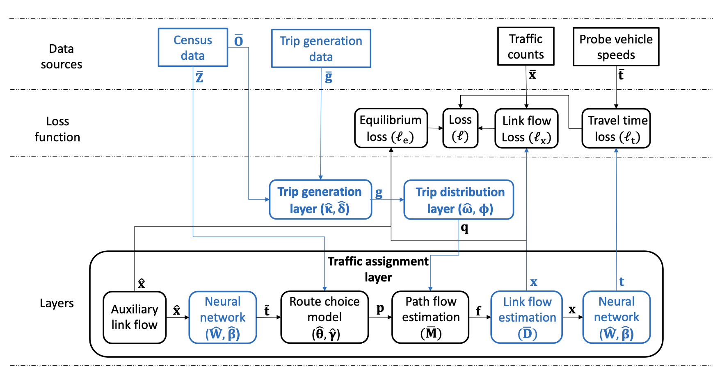

# MATwin

MATwin is a macroscopic traffic digital twin for urban road networks. It learns link performance functions, origin-destination (O-D) demand and route choice together from traffic counts and speeds, as a TensorFlow computational graph. Networks are built from OpenStreetMap, Caltrans PeMS and US Census data. MATwin extends [MaTE](https://github.com/pabloguarda/mate) (Guarda and Qian, 2025).

A paper describing MATwin is under review. Its citation will be added here once it is published.



## Repository layout

```
src/
  mate/          MaTE models (TensorFlow): performance functions, O-D demand, route choice
  mattwin/       network builder (OSM, PeMS, Census), post-processing and intervention metrics
  isuelogit/     bundled network and equilibrium utilities used by mate (MIT)
  pesuelogit/    bundled network and estimation utilities used by mate (MIT)
examples/        notebooks 01-05, data/fig5/ and 06_siouxfalls_benchmark/
tests/
docs/images/
environment.yml  setup.py  LICENSE  THIRD_PARTY_LICENSES.md
```

## Installation

You need git and conda (for example [Miniforge](https://github.com/conda-forge/miniforge)):

```bash
git clone https://github.com/FujitsuResearch/MATwin.git
cd MATwin
conda env create -f environment.yml
conda activate mattwin
pip install -e .
pytest tests        # 21 tests, a few seconds
```

Conda packages come from conda-forge only; TensorFlow 2.11 (CPU), census, openmatrix, papermill and pytest come from PyPI. Everything runs on the CPU. `tensorflow-cpu` 2.11 has wheels for Linux x86_64, macOS x86_64 and Windows, but not for Apple Silicon. The shell commands below assume bash (on Windows, use WSL or Git Bash).

## Examples

| Example | What it shows | Paper | Data you must gather |
|---|---|---|---|
| `01_build_network.ipynb` | Builds the Fresno 25 km² network (5 x 5 km) from OSM, PeMS and Census data | Network behind Table 3 | Yes: PeMS account (see the PeMS note below), Census API key, TAZ shapefile |
| `02_train_polynomial.ipynb` | Trains MATwin with a polynomial performance function | Table 3, Fresno 25 km² | To re-run: the output of 01 |
| `03_train_modified_davidson.ipynb` | The same with a modified Davidson function | Table 3, Fresno 25 km² | To re-run: the output of 01 |
| `04_train_triangular.ipynb` | The same with a triangular function | Table 3, Fresno 25 km² | To re-run: the output of 01 |
| `05_figure5_pareto.ipynb` | Share of interventions with positive, negative or no savings in system total travel time (STTT) and vehicle miles travelled (VMT), for four cities | Figure 5 | No (uses `examples/data/fig5`) |
| `06_siouxfalls_benchmark/` | Calibrates on baseline data, then predicts 24 intervention cases on Sioux Falls and compares them with reference solutions | Figure 6 | No account; a script downloads the network |

Notebooks 02-04 contain the saved outputs of the paper runs (metrics, figures and maps), so you can read them without running anything. 01 ships without outputs.

## Gather data (examples 01-04)

> **PeMS availability (November 2026).** The PeMS website (https://pems.dot.ca.gov) currently shows only an upgrade page that offers the latest 5-minute data and station configuration files. The Data Clearinghouse that 01 downloads from (Station Metadata and Station Hour files) is not available, so 01 cannot download the PeMS files until it returns. The saved outputs of 02-04 still document the paper runs.

1. Request a free Caltrans PeMS account at https://pems.dot.ca.gov and a free Census API key at https://api.census.gov/data/key_signup.html.
2. All Fresno data go to `data/Fresno/250327231442/{input,output,models}` under the repository root, which git ignores. The folder name is the timestamp `ts` in the parameter cell of 01, and 02-04 read the same value from `ts_data`. If you change one, change the others to match.
3. Download the Census 2000 TAZ boundaries for California into that folder (from the repository root):
   ```bash
   D=data/Fresno/250327231442/input/TAZ_Shap_Files/tz06_d00_shp
   mkdir -p $D
   curl -L -o $D/tz06_d00_shp.zip https://www2.census.gov/geo/tiger/PREVGENZ/tz/tz00shp/tz06_d00_shp.zip
   unzip $D/tz06_d00_shp.zip -d $D     # tz06_d00.shp, .dbf, .shx
   ```
4. Start Jupyter from `examples/` in a shell where the credentials are set (the kernel reads them from the environment). The notebooks take the repository root to be the parent folder of their working directory.
   ```bash
   conda activate mattwin
   export PEMS_USERNAME=<your PeMS user name>
   export PEMS_PASSWORD=<your PeMS password>
   export CENSUS_API_KEY=<your Census API key>
   cd examples
   jupyter lab
   ```
5. Run `01_build_network.ipynb`. It needs internet access (PeMS, the OSM Overpass API and census.gov) and takes about 6 minutes plus downloads. It uses about 1.7 GB of disk. It does the following:
   - downloads the PeMS District 6 station metadata (`d06_text_meta_2023_08_08.txt`) and the August 2024 hourly station data (`d06_text_station_hour_2024_08.txt`, decompressed from `.txt.gz`) into `input/`;
   - downloads the OSM network for the 5 x 5 km box centred on 36.7394421, -119.78483, plus a 10 x 10 km box used to check the matching of stations to links;
   - builds `input/counties/counties.shp` once, from the ACS 2018 5-year tract population (B09019_001E, Census API) and TIGER 2018 tract boundaries;
   - writes the network, the virtual links and the hourly link data to `output/`. Examples 02-04 read `node_specific_data.csv`, `link_specific_data.csv`, `ref_g.csv` and `spatiotemporal_link_data_whole.csv` (about 1.5 GB) from there.

   `station_metadata_option=4` and `station_hr_data_option=8` are row numbers in the PeMS Clearinghouse listings that the download cell prints. If PeMS changes a listing, read the printed table and update the option number and the file name in the parameter cell. You can also download the two files by hand from the PeMS Data Clearinghouse (District 6, types Station Metadata and Station Hour), put them in `input/` with the hour file decompressed, and skip the download cell.
6. Run 02, 03 or 04. Each trains for 40 epochs on three weekdays in August 2024 (1, 6 and 7 August, hourly), and **takes about 17 hours on a CPU** in our runs: about 26 minutes for the k-shortest paths, the rest for training. They also need a lot of memory: the dense link-path and O-D-path matrices alone take about 15 GB (int64), and float32 copies are made during training, so a 16 GB machine is not enough. They need internet access for the OpenStreetMap tiles of the network map. They write `output/figures/results/`, `output/tables/` and a weights file in `models/`. Running them in Jupyter replaces the saved outputs when you save; the papermill command below writes to a new file instead. In the saved outputs, the last training epoch (`40/40: ...`) and the last `runtime:` line give the values reported in Table 3.

## Run the examples

**02-04** can also run without Jupyter, from the repository root, with papermill (here writing the executed copy of 02 to `data/`): `papermill --cwd examples examples/02_train_polynomial.ipynb data/02_train_polynomial.out.ipynb`.

**05 (Figure 5)** runs offline in about 15 seconds; start Jupyter from `examples/` as in step 4 above (no credentials needed). It reads the 16 saved intervention result files in `examples/data/fig5/{Fresno,SanJose,LosAngeles,SanDiego}/` and also writes PNG copies of the figures to `examples/outputs/`. The interventions are capacity expansion (ce), toll pricing (toll), partial road closure (PRC) and full road closure (FRC).

**06 (Figure 6)** takes about 6 minutes on one CPU core and needs internet access only for the download. From the repository root:

```bash
cd examples/06_siouxfalls_benchmark
./run_all.sh          # or: PYTHON=/path/to/python ./run_all.sh
```

`run_all.sh` runs these steps, which you can also run one at a time:
- `download_tntp.py`: fetches the network and demand files at a pinned commit and checks their sha256;
- `prepare.py`: builds the route catalogue, the reference logit stochastic user equilibrium (SUE) solutions and the 24 cases (4 interventions x 3 links x 2 demand levels);
- `calibrate.py --model cubic` and `calibrate.py --model bpr4`: calibrate on the baseline observations only, then solve the 24 cases;
- `results.py`: writes the tables and the figure;
- `certify_with_mate.py` (optional): checks every predicted state against MaTE's route-choice map.

Outputs go to `runs/` and the downloaded files to `downloads/`; git ignores both. The main outputs are `runs/cases_side_by_side.csv`, `runs/summary_by_intervention.csv` and `runs/pred_vs_ref.{png,pdf,svg}`. Expected results (t0 is the free-flow travel time and u = flow / capacity):

| Model | Fitted curve | Sign agreement | Median relative error |
|---|---|---|---|
| Cubic (city configuration) | t0 (1 + 0.2346 u³) | 24/24 | 0.275 |
| Quartic BPR | t0 (1 + 0.1500 u⁴) | 24/24 | 0.044 |

The city configuration is the MaTE setup used for the city networks: θ = -1 fixed, link fixed effects and generation x distribution demand (see `prepare.py`).

## Data sources and attribution

Apart from the model outputs in `examples/data/fig5` and the saved outputs of notebooks 02-04, this repository includes no data. The examples download everything else at run time from the sources below.

- **OpenStreetMap.** Road networks are downloaded with OSMnx, and the maps in the notebooks use OpenStreetMap tiles. Map data © OpenStreetMap contributors, available under the [Open Database License](https://www.openstreetmap.org/copyright). A network you build from it is a derived database under the ODbL.
- **US Census Bureau.** TIGER/Line tract boundaries, Census 2000 TAZ boundaries and ACS 5-year tract population. This product uses the Census Bureau Data API but is not endorsed or certified by the Census Bureau.
- **Caltrans PeMS.** Station metadata and hourly station data, downloaded with your own account and subject to the PeMS terms of use. The saved outputs of 02-04 show a few station rows and plots of observed and predicted counts.
- **Transportation Networks for Research.** Sioux Falls network and demand for example 06. Transportation Networks for Research Core Team. *Transportation Networks for Research*. https://github.com/bstabler/TransportationNetworks. The network data come from LeBlanc, L.J., Morlok, E.K., Pierskalla, W.P. (1975), An efficient approach to solving the road network equilibrium traffic assignment problem, *Transportation Research* 9, 309-318. These data sets are for academic research purposes only, and the files are downloaded by `download_tntp.py`, not redistributed here.

## Notes and limitations

- Validation in 02-04 uses the training days (the validation tensors are the training tensors), so the validation metrics are in-sample.
- Trained model weights are not distributed. To reproduce 02-04 you must rebuild the network and retrain.
- 02, 03 and 04 all save their weights to the same file name in `models/`, so each run overwrites the previous one. Rename the file between runs if you want to keep all three.
- 01 downloads current OSM data, so a rebuilt network differs slightly from the one used in the paper. A test rebuild gave 2,145 nodes, 7,246 links and 19 matched stations, against 2,143, 7,245 and 22. The rebuilt tract polygons also differ slightly, which changes `ref_g.csv` a little. The metrics of 02-04 on a rebuilt network will therefore differ from Table 3 and from the saved outputs.
- `tf_inrix` is a legacy column name for the free-flow travel time computed from OSM speed limits; no INRIX data are used.
- Figure 5's San Francisco column cannot be reproduced from the shipped results, because its inputs are not available. Notebook 05 shows the other four cities.

## License and credits

MATwin is released under the MIT License (see [LICENSE](LICENSE)). Third-party dependencies and their licenses are listed in [THIRD_PARTY_LICENSES.md](THIRD_PARTY_LICENSES.md). `src/mate`, `src/isuelogit` and `src/pesuelogit` are bundled copies of MIT-licensed packages by Pablo Guarda ([mate](https://github.com/pabloguarda/mate), [isuelogit](https://github.com/pabloguarda/isuelogit), [pesuelogit](https://github.com/pabloguarda/pesuelogit)), and all three have been modified.

MaTE was developed by Pablo Guarda under the guidance of Prof. Sean Qian. If you use the MaTE model, please also cite:

```
@article{GuardaQian2025macroscopic,
  title={Traffic estimation in unobserved network locations using data-driven macroscopic models},
  author={Guarda, Pablo and Qian, Sean},
  journal={Transportmetrica A: Transport Science},
  year={2025},
  doi={10.1080/23249935.2025.2511820}
}
```

A preprint is available at [arXiv:2401.17095](https://arxiv.org/abs/2401.17095).

The original MaTE project was partially funded through National Science Foundation Grant CMMI-1751448: [Probabilistic Network Flow Theory](https://www.nsf.gov/awardsearch/show-award/?AWD_ID=1751448).
